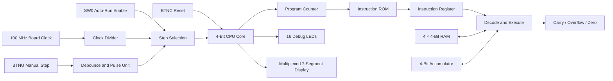

<div align="center">

# Hardware Engineering Lab SS2026


<br>


**A complete hardware-engineering repository containing digital-design laboratory exercises and a synthesizable 4-bit CPU implemented on an FPGA.**

[Featured Project](#featured-project-4-bit-cpu) · [Visual Overview](#visual-overview) · [Board Interface](#nexys-a7-board-interface) · [Run the Project](#running-the-fpga-project) · [Repository Structure](#repository-structure)

</div>

---

## Overview

This repository contains the laboratory work and final team project completed for the **Hardware Engineering Laboratory**. It brings together the full digital-hardware workflow:

- combinational and sequential circuit design in **VHDL**;
- behavioral simulation and assertion-based verification;
- FPGA synthesis, implementation, timing analysis, and bitstream generation in **AMD Vivado**;
- schematic capture, PCB layout, Gerber generation, BOM preparation, and 3D export in **Altium Designer**.

The main project is a compact **4-bit accumulator-based CPU** designed for the **Digilent Nexys A7-100T** FPGA board. Its internal state is observable through the onboard LEDs and multiplexed seven-segment display, making the processor suitable for demonstration and teaching.

## Team

| Role | Name |
|---|---|
| Team member | Naved Afridi Rashiq |
| Team member | Soaib Ferdous |
| Team member | Moaz Bin Alamgir Chowdhury |

## Supervisor/ Course Instructor
**Prof. Dr.-Ing. Ali Hayek**

## Project Management and Task Distribution
| Names | Task | Description |
|---|---|---|
| Naved Afridi Rashiq, Soaib Ferdous, Moaz Bin Alamgir Chowdhury | Planning | Jointly defined the 4-bit CPU concept, required modules, instruction sequence, FPGA demonstration method, and overall project workflow. |
| Naved Afridi Rashiq, Soaib Ferdous, Moaz Bin Alamgir Chowdhury | VHDL Coding | Jointly developed and reviewed the CPU core, ALU operations, ROM, RAM, accumulator, program counter, instruction register, flags, clock divider, button logic, display decoder, and top-level integration. |
| Naved Afridi Rashiq, Soaib Ferdous, Moaz Bin Alamgir Chowdhury | Verification | Jointly created and reviewed the testbench, checked Vivado waveforms, and verified the accumulator, program counter, instruction sequence, RAM values, and carry, overflow, and zero flags. |
| Naved Afridi Rashiq, Soaib Ferdous, Moaz Bin Alamgir Chowdhury | Testing on FPGA | Jointly generated and programmed the bitstream, tested manual and automatic execution on the Nexys A7 board, and confirmed the LED and seven-segment display outputs. |
| Naved Afridi Rashiq | PCB Design | Completed the full Altium work, including component selection, power design, schematic capture, FPGA interfaces, component placement, PCB routing, design checks, 3D model, BOM, and manufacturing outputs. |
| Naved Afridi Rashiq, Soaib Ferdous, Moaz Bin Alamgir Chowdhury | Presentation | Jointly prepared and delivered the project presentation, including the CPU architecture, instruction walkthrough, FPGA demonstration, flag explanation, LED mapping, and PCB overview. |
| Naved Afridi Rashiq, Soaib Ferdous, Moaz Bin Alamgir Chowdhury | Documentation | Jointly prepared, reviewed, and formatted the complete technical documentation covering the VHDL architecture, verification, FPGA testing, and custom PCB design. |

# Featured Project: 4-Bit CPU

## Project Objectives

The processor was developed to demonstrate the essential elements of a small computer system in a clear and observable form. The design integrates:

- a 4-bit accumulator;
- a 4-bit program counter and instruction register;
- a preprogrammed instruction ROM;
- four 4-bit RAM locations;
- an arithmetic and logic unit;
- carry/borrow, signed-overflow, and zero flags;
- automatic and manual instruction stepping;
- debounced push-button control;
- LED-based binary monitoring;
- a four-digit hexadecimal status display.

## CPU Architecture



One clean `step_enable` pulse executes exactly one instruction. In automatic mode, the 100 MHz board clock is divided to approximately **one CPU step per second**. In manual mode, the debounced `BTNU` input produces a single pulse for each valid button press.

## Visual Overview

### Synthesized RTL Schematic and FPGA Implementation

<table>
  <tr>
    <td align="center" width="50%">
      
      <br><strong>Synthesized RTL schematic</strong>
    </td>
    <td align="center" width="50%">
      
      <br><strong>Implemented FPGA design and timing summary</strong>
    </td>
  </tr>
</table>

The schematic shows the integration of the CPU core, clock divider, manual-step unit, display multiplexer, and seven-segment decoder. The implementation view confirms placement and routing on the target FPGA; the captured timing report shows that the specified timing constraints are met.

### Functional Simulation

<p align="center">
  
</p>

The testbench verifies the complete demonstration program, including accumulator results, program-counter progression, instruction decoding, RAM access, arithmetic flags, shift operations, and the jump back to address zero.

---

## Instruction Set

The instruction word is four bits wide. Each opcode performs a defined operation using the accumulator and, where applicable, a fixed RAM location.

| Opcode | Hex | Instruction | Operation |
|:---:|:---:|---|---|
| `0000` | `0` | `LOAD RAM[0]` | `ACC ← RAM[0]` |
| `0001` | `1` | `ADD RAM[1]` | `ACC ← ACC + RAM[1]` |
| `0010` | `2` | `SUB RAM[2]` | `ACC ← ACC - RAM[2]` |
| `0011` | `3` | `AND RAM[3]` | `ACC ← ACC AND RAM[3]` |
| `0100` | `4` | `INVERT` | `ACC ← NOT ACC` |
| `0101` | `5` | `SHIFT LEFT` | Logical left shift; shifted-out MSB enters the carry flag |
| `0110` | `6` | `SHIFT RIGHT` | Logical right shift; shifted-out LSB enters the carry flag |
| `0111` | `7` | `STORE RAM[0]` | `RAM[0] ← ACC` |
| `1000` | `8` | `JUMP START` | `PC ← 0` |

### Initial RAM Contents

| Address | Binary | Hex | Decimal | Purpose |
|:---:|:---:|:---:|---:|---|
| `RAM[0]` | `0111` | `7` | 7 | Initial accumulator value |
| `RAM[1]` | `0001` | `1` | 1 | Addition, overflow, and carry demonstrations |
| `RAM[2]` | `1000` | `8` | 8 | Subtraction-to-zero demonstration |
| `RAM[3]` | `1111` | `F` | 15 | Logical AND mask |

## Demonstration Program

The ROM executes the following sequence and then repeats continuously:

| ROM Address | Instruction | Result / Purpose |
|:---:|---|---|
| `0` | `LOAD RAM[0]` | Loads `7` into the accumulator |
| `1` | `ADD RAM[1]` | `7 + 1 = 8`; demonstrates signed overflow |
| `2` | `SUB RAM[2]` | `8 - 8 = 0`; activates the zero flag |
| `3` | `INVERT` | Converts `0` to `F` |
| `4` | `ADD RAM[1]` | `F + 1 = 0`; activates carry and zero |
| `5` | `LOAD RAM[0]` | Restores the accumulator to `7` |
| `6` | `AND RAM[3]` | `7 AND F = 7` |
| `7` | `STORE RAM[0]` | Writes the accumulator back to RAM |
| `8` | `SHIFT LEFT` | Converts `7` to `E` |
| `9` | `SHIFT RIGHT` | Converts `E` back to `7` |
| `A` | `JUMP START` | Returns the program counter to address `0` |

---

## Nexys A7 Board Interface

### Controls

| Board Input | Function |
|---|---|
| `SW0` | Enables automatic execution at approximately one instruction per second |
| `BTNU` | Executes one instruction manually |
| `BTNC` | Resets the CPU, RAM contents, flags, and program counter |

### LED Mapping

| LEDs | Meaning |
|---|---|
| `LED3 ... LED0` | Accumulator, `ACC[3:0]` |
| `LED7 ... LED4` | Program counter, `PC[3:0]` |
| `LED11 ... LED8` | Current instruction, `IR[3:0]` |
| `LED12` | Zero flag `Z` |
| `LED13` | Signed-overflow flag `O` |
| `LED14` | Carry / subtraction-borrow flag `C` |
| `LED15` | Automatic-mode status |

### Seven-Segment Display Format

Only the four rightmost digits are used. Read from **left to right**, the display format is:

<div align="center">

### `[ Flags ][ Instruction ][ PC ][ ACC ]`

</div>

The flag digit is packed as the four-bit value `0COZ`, where:

- `C` = carry or subtraction borrow;
- `O` = signed overflow;
- `Z` = zero result.

This arrangement makes the displayed flag digit match the binary order of `LED14`, `LED13`, and `LED12`.

| Example Display | Interpretation |
|:---:|---|
| `1000` | Reset state: `Z=1`, instruction `0`, `PC=0`, `ACC=0` |
| `2128` | Overflow active, instruction `1` (`ADD`), next `PC=2`, `ACC=8` |
| `1230` | Zero active, instruction `2` (`SUB`), next `PC=3`, `ACC=0` |
| `044F` | No flags, instruction `4` (`INVERT`), next `PC=4`, `ACC=F` |
| `5150` | Carry and zero active, instruction `1` (`ADD`), next `PC=5`, `ACC=0` |

> **Display timing note:** the instruction register shows the instruction that has just executed, while the program counter already points to the next ROM address. Therefore, after the subtraction at address `2`, the expected display is `1230`: flags `1`, instruction `2`, next PC `3`, accumulator `0`.

---

## Verification and Implementation Status

| Stage | Result |
|---|---|
| Behavioral simulation | Completed with assertion checks for every ROM instruction |
| CPU datapath and control verification | ACC, PC, IR, RAM, ALU operations, flags, and jump behavior verified |
| Synthesis | Completed in Vivado |
| FPGA implementation | Placement and routing completed |
| Timing analysis | Specified timing constraints met |
| Bitstream generation | Completed; programming file included in the repository |

The testbench is located at:

```text
Project/4-bit CPU Project/Implementation in VHDL/tb/tb_cpu4_core.vhd
```

---

## PCB Design Package

The repository also contains an Altium-based PCB design package for the hardware concept, including fabrication and mechanical outputs.

| Deliverable | File |
|---|---|
| Altium schematic source | [`A3P600_4Bit_CPU.SchDoc`](./Project/4-bit%20CPU%20Project/PCB%20Design%20Altium/Schematic/A3P600_4Bit_CPU.SchDoc) |
| Schematic PDF | [`Schematic_altium.pdf`](./Project/4-bit%20CPU%20Project/PCB%20Design%20Altium/Schematic/Schematic_altium.pdf) |
| PCB layout source | [`4Bit_CPU_PCB_TEAM_C4.PcbDoc`](./Project/4-bit%20CPU%20Project/PCB%20Design%20Altium/PCB%20layout/4Bit_CPU_PCB_TEAM_C4.PcbDoc) |
| 2D PCB view | [`PCB_Design_2D view.pdf`](./Project/4-bit%20CPU%20Project/PCB%20Design%20Altium/Design%20Views/PCB_Design_2D%20view.pdf) |
| 3D PCB view | [`PCB_Design_3D view.pdf`](./Project/4-bit%20CPU%20Project/PCB%20Design%20Altium/Design%20Views/PCB_Design_3D%20view.pdf) |
| 3D STEP model | [`4Bit_CPU_PCB_TEAM_C4.step`](./Project/4-bit%20CPU%20Project/PCB%20Design%20Altium/3D%20File/4Bit_CPU_PCB_TEAM_C4.step) |
| Bill of materials | [`4-Bit CPU HWE.xlsx`](./Project/4-bit%20CPU%20Project/PCB%20Design%20Altium/BOM/4-Bit%20CPU%20HWE.xlsx) |
| Gerber fabrication files | [`Gerber Files`](./Project/4-bit%20CPU%20Project/PCB%20Design%20Altium/Gerber%20Files/) |

---

## Project Resources

| Resource | Link |
|---|---|
| Complete technical documentation | [4-Bit CPU Documentation](./Project/4-bit%20CPU%20Project/Documentation/4_Bit_CPU_Documentation.pdf) |
| Project presentation | [Presentation 4 Bit CPU](./Project/Presentation/Presentation%204%20Bit%20CPU.pptx) |
| Automatic-mode FPGA demonstration | [Watch the MP4 demo](./Project/4-bit%20CPU%20Project/Video%20Demo/4BitCPU_Automatic_Mode.mp4) |
| Generated FPGA bitstream | [cpu4_top.bit](./Project/4-bit%20CPU%20Project/Implementation%20in%20VHDL/Bit%20File/cpu4_top.bit) |
| Concept draft | [Concept Draft](./Project/Concept%20Draft/Concept%20Draft.pdf) |

---

## Running the FPGA Project

### Prerequisites

- AMD Vivado with support for the Digilent Nexys A7-100T;
- a Nexys A7-100T development board for hardware execution;
- a USB cable for board programming and power;
- optional: Altium Designer for editing the PCB source files.

### 1. Create the Vivado Project

Create a new RTL project and select the **Nexys A7-100T** board preset or the corresponding Artix-7 device.

Add the following VHDL design sources:

```text
Project/4-bit CPU Project/Implementation in VHDL/src/clock_divider.vhd
Project/4-bit CPU Project/Implementation in VHDL/src/manual_step_unit.vhd
Project/4-bit CPU Project/Implementation in VHDL/src/cpu_core_unit.vhd
Project/4-bit CPU Project/Implementation in VHDL/src/sevenseg_hex.vhd
Project/4-bit CPU Project/Implementation in VHDL/src/cpu_4_bit_top.vhd
```

Add the constraint file:

```text
Project/4-bit CPU Project/Implementation in VHDL/constraint/Nexys_A7_100T_cpu.xdc
```

Set `cpu4_top` as the top-level entity.

### 2. Run the Simulation

Add the testbench as a simulation source:

```text
Project/4-bit CPU Project/Implementation in VHDL/tb/tb_cpu4_core.vhd
```

Run **Behavioral Simulation**. The testbench executes the full ROM sequence and reports an error if any instruction, flag, RAM value, or program-counter result is incorrect.

### 3. Generate and Program the Bitstream

Run:

```text
Synthesis → Implementation → Generate Bitstream
```

Open **Hardware Manager**, connect the board, and program it with the generated bitstream or the included file:

```text
Project/4-bit CPU Project/Implementation in VHDL/Bit File/cpu4_top.bit
```

After programming:

1. press `BTNC` to reset the CPU;
2. press `BTNU` to execute instructions individually; or
3. set `SW0` high to enable automatic execution.

---
## Repository Structure

```text
SS2026_HWE_Lab_Team_C4-main/
├── Project/
│   ├── 4-bit CPU Project/
│   │   ├── Documentation/
│   │   ├── Implementation in VHDL/
│   │   │   ├── Bit File/
│   │   │   ├── constraint/
│   │   │   ├── src/
│   │   │   └── tb/
│   │   ├── PCB Design Altium/
│   │   │   ├── 3D File/
│   │   │   ├── BOM/
│   │   │   ├── Design Views/
│   │   │   ├── Gerber Files/
│   │   │   ├── PCB layout/
│   │   │   └── Schematic/
│   │   ├── Screenshots_Vivado/
│   │   └── Video Demo/
│   ├── Concept Draft/
│   └── Presentation/
├── labs/
│   ├── lab01/   # Half/full adders and subtractors
│   ├── lab02/   # Ripple-carry, add/subtract, BCD, and 7-segment designs
│   ├── lab03/   # Altium schematic work
│   ├── lab04/   # PCB layout and design-rule checking
│   ├── lab05/   # FPGA constraints and generated bitstreams
│   └── lab07/   # Clock divider and counter designs
├── Task Management.xlsx
└── README.md

```
<div align="center">

### Team C4 · Hardware Engineering Laboratory · Summer Semester 2026

</div>
